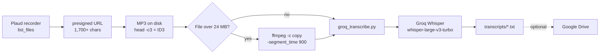

<p align="center">
  
</p>

# Plaud-Groq-Transcribe

<p align="left">
  
  
  
</p>

**Automatically transcribe Plaud voice recordings using Groq Whisper.** Turn meetings, coaching sessions, and interviews into text — free, Korean-friendly, and production-tested.

> This repository is the **generalized (de-personalized) version**. Personal data (emails, accounts, internal paths) has been removed.

---

## Why use this

- **Free** — Runs on Groq's free tier (`whisper-large-v3`). No OpenAI or per-audio cost.
- **Korean-accurate** — Sets `language="ko"` for accurate transcription of Korean meetings, coaching, and interviews.
- **Simple** — Pure Python standard library (no `requests` needed). One-line setup.
- **Battle-tested workarounds included** — handles presigned-URL poisoning, Cloudflare blocking, and file-size limits that most tutorials skip.
- **Extensible** — split >24 MB audio with `ffmpeg` (see pitfalls) and upload results to Google Drive.

In short: **a "record → text, instantly" meeting/coaching/interview log tool.**

---

## Pipeline



Everything that can break between those two points is listed under [Pitfalls & solutions](#pitfalls--solutions-production-tested).

---

## Install

```bash
# Groq API key (free tier: console.groq.com)
export GROQ_API_KEY="gsk_..."
```

Works with the Python standard library — no extra package install required (`requests` is optional).

---

## Usage & examples

### Prepare
```bash
mkdir -p transcripts    # optional — the script creates it automatically
```

### Transcribe one file (default = fast model)
```bash
python3 groq_transcribe.py meeting.mp3
# → transcripts/meeting.txt  (finishes in ~1–2 min)
```

### Accuracy-first + custom output path
```bash
python3 groq_transcribe.py lecture.mp3 ./out/lecture.txt whisper-large-v3
```

### Non-Korean audio (language defaults to ko)
```bash
python3 groq_transcribe.py interview.mp3 --language=en
```

### Example run (real input/output)

Input: `/audio/coaching1.mp3` (4.6MB / 14 min)

```bash
python3 groq_transcribe.py /audio/coaching1.mp3
```

Console output:
```
오디오 크기: 4600000 bytes
전사 성공: 12,340자
저장: transcripts/coaching1.txt
```

Resulting `transcripts/coaching1.txt` (excerpt):

```
안녕하세요, 오늘 코칭 세션의 목표는...
```

---

## Pitfalls & solutions (production-tested)

### 1. Presigned-URL poisoning — the most common failure cause
Plaud presigned URLs are **1,700+ characters** (mostly the `X-Amz-Security-Token`). If you hand-paste the URL into code, even one mistyped character triggers **HTTP 400/403**.

**Fix**:
1. Save the URL to a file (e.g. `url.txt`).
2. Download with `curl -sL -o out.mp3 "$(cat url.txt)"`.
3. Verify with `head -c3 out.mp3` → `ID3` is good; `<?xml`/`<Error>` means corrupted URL.

### 2. Groq `file is empty` (intermittent)
Caused by Groq session degradation, or by inputs that are large relative to the model's sweet spot.
→ Wait 1–2 min and retry (max 3 attempts); if it repeats, split into 10–15 min chunks.

### 3. Groq 403 `error code: 1010` = Cloudflare UA block
The audio-upload endpoint blocks the default `urllib` User-Agent. → Set a browser User-Agent header (bundled in this script).

### 4. 25MB Groq limit
Plaud codec ≈ 0.23MB/min → ~109 min/file cap.
→ Split into 15-min chunks with `ffmpeg -c copy -segment_time 900`, keeping the source extension (`-c copy` into a different container fails).
→ Anything over 24MB is now rejected locally before upload, with that exact command printed.

### 5. Silent failures (exit code)
The script used to exit **0** even when Groq errored, so cron and CI saw success.
→ It now exits **1** on HTTP errors, files over 24MB, and empty transcripts. `if ! python3 groq_transcribe.py x.mp3; then ...` works.

---

## Use with AI agents

This repo ships an [Agent Skill](https://agentskills.io) at `.agents/skills/plaud-transcribe/`. Point your coding agent at it and it can run the whole pipeline, including the parts the script does not enforce.

| Agent | Where skills are read from | Install |
| --- | --- | --- |
| Claude Code | `~/.claude/skills/` (or `.claude/skills/` in the repo) | `cp -r .agents/skills/plaud-transcribe ~/.claude/skills/` |
| OpenAI Codex | `$CODEX_HOME/skills` (default `~/.codex/skills`) | `cp -r .agents/skills/plaud-transcribe "${CODEX_HOME:-$HOME/.codex}/skills/"` |
| OpenClaw | `.agents/skills/` in the repo, plus `~/.openclaw/skills/` | use it in place, or copy to `~/.openclaw/skills/` |
| Hermes Agent | `~/.hermes/skills/` | `cp -r .agents/skills/plaud-transcribe ~/.hermes/skills/` |

The skill covers the three things a wrapper still has to do around the script: split files that exceed Groq's per-request limit, convert containers the upload would otherwise reject, and check that the transcript file is actually non-empty instead of trusting the exit code alone.

## License
This repository has no `LICENSE` file yet, so the default all-rights-reserved applies. Adding one is the maintainer's call and is not part of this PR.

## Disclaimer
Built for personal use. Not an official Plaud or Groq product.