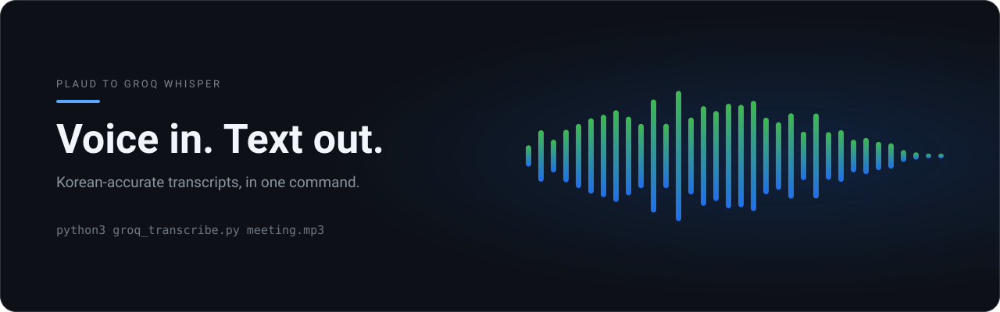
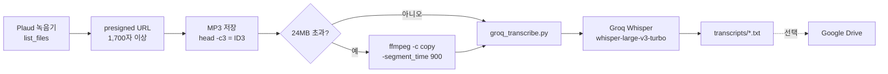

<p align="center">
  
</p>

# Plaud-Groq-Transcribe

<p align="left">
  
  
  
</p>

**Plaud 음성 녹음기를 Groq Whisper로 자동 전사하는 파이프라인.** 회의·코칭·인터뷰 녹음을 한국어로 텍스트화하고, 필요 시 Google Drive에 저장합니다.

> 이 저장소는 **범용화(일반화)된 버전**입니다. 개인정보(이메일·계정·내부 경로)는 제거했습니다.

---

## 왜 좋은가 (핵심 가치)

- **무료** — Groq 무료 티어(`whisper-large-v3`)로 오디오 전사. OpenAI·별도 비용 없음.
- **한국어 정확성** — `language="ko"` 지정으로 한국어 회의·코칭·인터뷰 전사 정확도가 높습니다.
- **간단** — 표준 파이썬 표준 라이브러리만으로 동작(`requests` 조차 필수 아님), 설치 1줄.
- **실전 검증된 함정 해결 포함** — presigned URL 오염·Cloudflare 차단·용량 제한 대응 내장.
- **확장 가능** — 24MB 초과 파일은 `ffmpeg`로 분할(함정 4번), 결과는 Google Drive에 저장.

한마디로: **"녹음하면 텍스트가 바로 나오는"** 회의·코칭·인터뷰 자동 기록 도구입니다.

---

## 구조



위 경로에서 깨질 수 있는 지점은 아래 함정 항목에 전부 정리되어 있습니다.

---

## 설치

```bash
# Groq API 키 (무료 티어 발급: console.groq.com)
export GROQ_API_KEY="gsk_..."
```

파이썬 표준 라이브러리로 동작 — 별도 패키지 설치 불필요 (`requests`는 선택).

---

## 사용법 & 예제

### 준비
```bash
mkdir -p transcripts    # 선택 — 스크립트가 없으면 자동 생성합니다
```

### 파일 1개 전사 (기본 = 빠른 모델)
```bash
python3 groq_transcribe.py meeting.mp3
# → transcripts/meeting.txt  (1~2분 내 완료)
```

### 정확도 우선 + 출력 경로 지정
```bash
python3 groq_transcribe.py lecture.mp3 ./out/lecture.txt whisper-large-v3
```

### 영어 등 다른 언어 오디오
```bash
python3 groq_transcribe.py interview.mp3 --language=en
# 또는 GROQ_LANGUAGE=en python3 groq_transcribe.py interview.mp3
```

### 실행 예시 (실제 입출력)

입력: `/audio/coaching1.mp3` (4.6MB / 14분)

```bash
python3 groq_transcribe.py /audio/coaching1.mp3
```

콘솔 출력:
```
오디오 크기: 4600000 bytes
전사 성공: 12,340자
저장: transcripts/coaching1.txt
```

생성된 `transcripts/coaching1.txt` 내용 (일부):

```
안녕하세요, 오늘 코칭 세션의 목표는...
```

---

## 함정 & 해결 (실전 검증)

### 1. presigned URL 오염 — 가장 빈번한 실패 원인
Plaud의 presigned URL은 **1,700자 이상**(대부분 `X-Amz-Security-Token`). 코드에 손으로 붙여넣으면 1글자만 틀려도 **HTTP 400/403**.

**정답**:
1. URL을 파일로 저장 (`url.txt`)
2. 다운로드: `curl -sL -o out.mp3 "$(cat url.txt)"`
3. 검증: `head -c3 out.mp3` → `ID3`이면 정상, `<?xml`/`<Error>`면 오염

### 2. Groq `file is empty` (간헐 오류)
Groq 세션 저하 또는 15MB 초과 파일에서 발생.
→ 1~2분 대기 후 재시도, 15MB 초과 시 10~15분 청크 분할, 최대 3회까지.

### 3. Groq 403 `error code: 1010` = Cloudflare UA 차단
오디오 업로드 엔드포인트가 기본 `urllib` UA를 차단. → 브라우저 UA 헤더 명시 (스크립트 내장).

### 4. 25MB Groq 제한
Plaud 코드 약 0.23MB/분 → 파일당 약 109분 한계.
→ `ffmpeg -c copy -segment_time 900`로 15분 청크 분할. 확장자는 원본 그대로 둡니다(`-c copy`로 컨테이너를 바꾸면 실패).
→ 24MB를 넘는 파일은 업로드 전에 로컬에서 거부하고 위 분할 명령을 그대로 출력합니다.

### 5. 조용한 실패 (종료 코드)
예전 버전은 Groq 오류·빈 응답에도 **종료 코드 0**을 반환해 크론·CI가 실패를 못 잡았습니다.
→ 지금은 HTTP 오류, 24MB 초과, 빈 전사 결과에서 **종료 코드 1**을 반환합니다. `if ! python3 groq_transcribe.py x.mp3; then ...` 로 감지하세요.

---

## AI 에이전트와 함께 쓰기

이 저장소에는 [Agent Skill](https://agentskills.io) 규격의 스킬이 `.agents/skills/plaud-transcribe/`에 들어 있습니다. 에이전트에게 이 폴더를 물려주면 파이프라인 전체를 알아서 돌립니다.

| 에이전트 | 스킬을 읽는 위치 | 설치 |
| --- | --- | --- |
| Claude Code | `~/.claude/skills/` (저장소 안이면 `.claude/skills/`) | `cp -r .agents/skills/plaud-transcribe ~/.claude/skills/` |
| OpenAI Codex | `$CODEX_HOME/skills` (기본 `~/.codex/skills`) | `cp -r .agents/skills/plaud-transcribe "${CODEX_HOME:-$HOME/.codex}/skills/"` |
| OpenClaw | 저장소의 `.agents/skills/` 자동 인식, `~/.openclaw/skills/` | 그대로 쓰거나 `~/.openclaw/skills/`로 복사 |
| Hermes Agent | `~/.hermes/skills/` | `cp -r .agents/skills/plaud-transcribe ~/.hermes/skills/` |

스킬은 스크립트 바깥에서 여전히 필요한 세 가지를 담당합니다. Groq 요청 한도를 넘는 파일을 나누는 일, 업로드가 거부할 컨테이너를 변환하는 일, 종료 코드만 믿지 않고 전사 파일이 실제로 비어 있지 않은지 확인하는 일입니다.

## 라이선스
아직 `LICENSE` 파일이 없어 기본 저작권(모든 권리 유보)이 적용됩니다. 라이선스 선택은 메인테이너 몫이며 이 PR에서 바꾸지 않습니다.

## 면책
개인 사용 목적으로 개발. Plaud·Groq 공식 제품 아님.