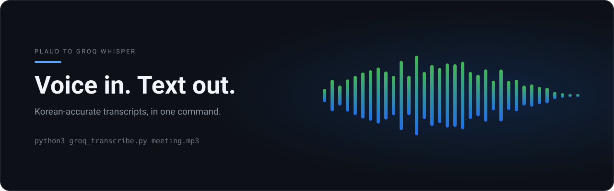
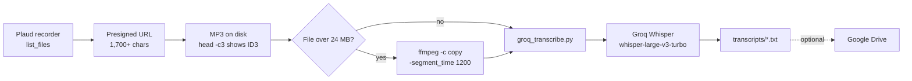

<p align="center">
  
</p>

# Plaud-Groq-Transcribe

<p align="left">
  
  
  
</p>

**Automatically transcribe Plaud voice recordings using Groq Whisper.** Turn meetings, coaching sessions, and interviews into text — free, Korean-friendly, and production-tested.

> 🇬🇧 Full English guide: [README.en.md](README.en.md)
> 🇰🇷 한국어 전체 가이드: [README.ko.md](README.ko.md)

---

## Why use this

- **Free** — Runs on Groq's free tier (`whisper-large-v3`). No OpenAI or runtime cost.
- **Korean-accurate** — `language="ko"` for accurate Korean meetings/coaching/interviews.
- **Simple** — Pure Python standard library (no `requests` required). One-line setup.
- **Battle-tested workarounds included** — handles the presigned-URL poisoning and Cloudflare blocks that most tutorials skip.
- **Extensible** — split >24 MB files with `ffmpeg` (see pitfalls) and upload results to Google Drive.

---

## Quick start

```bash
export GROQ_API_KEY="gsk_..."
mkdir -p transcripts

# Default (fast model)
python3 groq_transcribe.py meeting.mp3

# Accuracy-first + custom output path
python3 groq_transcribe.py lecture.mp3 ./out/lecture.txt whisper-large-v3

# Non-Korean audio (language defaults to ko)
python3 groq_transcribe.py interview.mp3 --language=en
```

Output is saved to `transcripts/<basename>.txt`.

---

## Pipeline



Groq downloads the file and returns JSON; the script writes plain text and stops. Everything that can break between those two points is listed under [Common pitfalls](#common-pitfalls-solved).

---

## Common pitfalls (solved)

1. **Presigned URL poisoning** — Plaud URLs exceed 1,700 chars (mostly `X-Amz-Security-Token`). Pasting them by hand into code breaks one character → HTTP 400/403. **Fix**: save URL to a file, download with `curl -sL -o out.mp3 "$(cat url.txt)"`, verify `head -c3` returns `ID3`.
2. **Groq `file is empty`** — retry after 1–2 min, split files >15MB, max 3 attempts.
3. **Groq 403 `error code: 1010`** = Cloudflare blocking default `urllib` UA → set a browser User-Agent (bundled in the script).
4. **25MB Groq limit** — Plaud ~0.23MB/min → ~109 min/file cap. Split with `ffmpeg -c copy -segment_time 1200` (20-min chunks). Files over 24MB are rejected locally with that command printed, so you never waste the upload.
5. **Silent failures** — the script used to exit 0 even when Groq returned an error. It now exits 1 on HTTP errors, oversized input, or an empty transcript, so `if ! python3 groq_transcribe.py x.mp3; then ...` works in cron/CI.

---

## Use with AI agents

This repo ships an [Agent Skill](https://agentskills.io) at `.agents/skills/plaud-transcribe/`. Point your coding agent at it and it can run the whole pipeline, including the parts the script does not enforce.

| Agent | Where skills are read from | Install |
| --- | --- | --- |
| Claude Code | `~/.claude/skills/` (or `.claude/skills/` in the repo) | `cp -r .agents/skills/plaud-transcribe ~/.claude/skills/` |
| OpenAI Codex | `$CODEX_HOME/skills` (default `~/.codex/skills`) | `cp -r .agents/skills/plaud-transcribe "${CODEX_HOME:-$HOME/.codex}/skills/"` |
| OpenClaw | `.agents/skills/` in the repo, plus `~/.openclaw/skills/` | use it in place, or copy to `~/.openclaw/skills/` |
| Hermes Agent | `~/.hermes/skills/` | `cp -r .agents/skills/plaud-transcribe ~/.hermes/skills/` |

The skill covers the three things a wrapper still has to do around the script: split files that exceed Groq's per-request limit, convert containers the upload would otherwise reject, and check that the transcript file is actually non-empty instead of trusting the exit code alone.

## License
This repository has no `LICENSE` file yet, so the default all-rights-reserved applies. Adding one is the maintainer's call and is not part of this PR.

## Disclaimer
Built for personal use. Not an official Plaud or Groq product.
